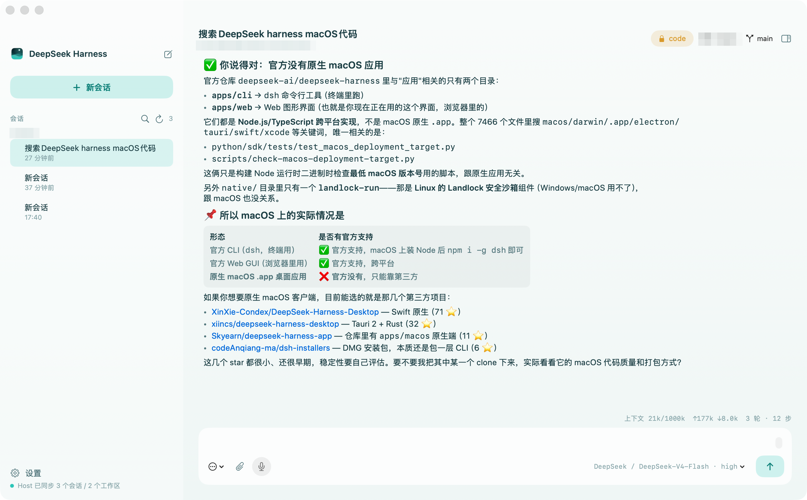

# DeepSeek Harness — Native macOS App

中文 | [English](README.en.md)

[](https://github.com/luochenw/deepseek-harness-macos/actions/workflows/ci.yml)
[](https://github.com/luochenw/deepseek-harness-macos/releases/latest)
[](LICENSE)


这是一个独立的、**非官方**的 SwiftUI/AppKit 原生 macOS 客户端，面向 [DSH](https://github.com/deepseek-ai/deepseek-harness)（DeepSeek Harness）——不是把 DSH Web UI 套进 WebView 的壳。应用界面由 macOS 原生 API 实现；WebKit 只用于右侧工作台中用户打开或模型请求打开的浏览器标签。

Agent 推理、工具、MCP、终端、文件系统与子代理仍由 DSH runtime 提供。App 内置 Node.js 和完整 DSH runtime，运行时不依赖系统已安装的 node 或 dsh。



## 原生功能

- SwiftUI 原生三栏界面、流式输出、运行/停止状态与键盘快捷键。
- 全产品使用统一的原生工作台设计系统：冷中性实体表面、从原始 App Icon 实际像素采样得到的水蓝底色 `#A2E4E0` 作为唯一主色，主操作统一使用 `#A2E4E0` 配白字；统一 SF 字体层级、紧凑圆角和共享按钮/表单状态，不修改 Logo 本身，也不引入另一套主色。
- 任务运行中可在主窗口任意非输入区域按 `Esc` 终止当前根任务或可续写子代理；输入框、输入法、弹窗和菜单仍优先处理自己的 `Esc`。
- 左侧按项目折叠会话；每个项目默认只显示最近 5 个，更多会话按需展开。
- 打开旧会话时显示该 Host 会话自己的固定工作目录；工作区选择器只影响尚未创建的新会话。
- 会话正文使用更大的字号、行距和清晰的结构化图标；输入框与正文共享同一阅读宽度，代码块支持行数提示、折叠与一键复制，表格和引用也有独立视觉层次。
- 运行中的思考和工具活动保持为一条折叠状态栏，持续显示最新思考、正文或工具动作；结束后再收敛为可展开的“思考过程”，不会把整轮推理铺开成日志墙。
- 运行中的指令和侧栏 session 使用同一组动态活动波形与“运行中”文字，完成/空闲时不播放循环动画，并遵循 macOS“减少动态效果”设置。
- 输入框可直接粘贴截图或复制多张图片文件，也可一次选择多张图片；草稿以缩略图预览，支持单张删除和点击放大查看。
- 所有工具执行统一为两级折叠：外层折叠时直接显示当前或最后一次具体指令；展开后只列出一条条指令，列表超过 `320pt` 后在内部滚动，不再平铺结果或撑高会话。`run_code` 会展开为真实的 child tool calls，并从 command、文件路径、pattern、URL 等参数生成指令标题；不展示 `{}`、泛化兜底文案、调用次数或按工具切换图标。每条指令可单独展开自己的执行结果。
- 输入框内置 Host 权限菜单：只读、工作区访问与完全访问；默认权限和当前会话权限分别管理，完全访问启用前会明确确认风险。
- Agent 运行时输入框保持可用；队列为空时发送会直接进入当前轮，已有排队消息时才显示 Queue 操作并可继续排队；通用设置控制已有队列时的 Enter 行为。
- 打开持久会话时先立即显示最近内容并恢复输入，再在后台自动增量补齐 Host 历史分页；已到达的历史会逐页补到上方，最终保留完整对话，不需要手动“载入更早消息”或切换本地消息窗口。
- 输入框的模型标签会打开统一选择面板，同时展示真实的模型目录与当前模型可用的推理强度；选择在点击后直接提交给 Host，不依赖会因悬停计时关闭的二级菜单。
- 会话级右侧多标签工作台：可调宽、可折叠，原生承载内置浏览器、Markdown 阅读器、执行、Agent 与工具详情；切换标签或会话不会重建浏览器页面。模型可调用 `open_workbench_browser` / `open_workbench_markdown` 请求为当前任务打开标签，但不能读取 DOM、注入脚本、点击网页或获得页面/文档内容。
- NSOpenPanel 原生工作区入口；已选工作区持久化在 macOS 用户偏好中。
- 本地任务从所选工作区启动，DSH 可执行终端、读取/修改文件、使用技能及配置好的本地工具。
- 子代理会话是叠加在对话面板上的独立、实时流式视图（而非插入侧边栏的伪顶层会话），带只读/可续写的可视区分与面包屑导航。
- 可复用的 Agent Profile 可从 Composer、手动运行 Sheet 或已授权的 Agent/Subagent 工具调用，同时派发 DSH、Claude Code、Codex 与 ZCode。后三种外部 Runtime 需要在本机另行安装并完成各自认证。右侧工作台统一展示持久 Batch、成员日志、停止/重试/丢弃、不可变运行快照和主 Agent 选择性整合。
- 执行成员必须使用独立 Git worktree。每个 Batch 在创建时冻结发起会话的 cwd、sandbox、模型、工具面和 Agent Preset；外部 CLI 经过 DSH sandbox provider，DSH continuable context 则复用 worktree 直到采纳或丢弃。
- 常驻菜单栏图标 + 系统通知，覆盖审批请求、Agent 提问与本轮任务完成——这是浏览器标签页在架构上做不到的能力。
- 唤醒词听写会按前后台路由：App 在对话界面前台时发送到当前会话，后台时派发独立会话；关闭自动发送后只保留到输入框。
- 设置 → 用量展示当前会话的上下文占用、累计输入/输出 token、缓存读写/命中率与 LLM/工具耗时；数值来自 Host 实时投影，不伪造账户余额、剩余额度或费用。
- 设置编辑器内置两选一的 revision 冲突恢复（放弃修改重载 / 保留修改基于最新版本重试），而不是让保存操作静默卡住。
- 原生 Finder 打开工作区、运行时设置面板、错误诊断与退出生命周期。
- 内置与发布包架构匹配的 Node.js 与完整 DSH runtime；不依赖全局 npm 安装或 Finder 的 PATH。

完整的"对照 web 客户端实现了什么、哪些是原生独有能力、还有哪些没做"的活文档见 [macos/WEB_PARITY.md](macos/WEB_PARITY.md)。

## 安装

从[最新 Release](https://github.com/luochenw/deepseek-harness-macos/releases/latest) 下载 zip（Apple Silicon，macOS 14+），解压后把 **DeepSeek Harness.app** 拖进「应用程序」。

> **Gatekeeper 提示：**Release 构建为 ad-hoc 签名、未经 notarize——首次打开会被 macOS 拦截。打开「系统设置 → 隐私与安全性」点「仍要打开」，或执行：
>
> ```bash
> xattr -rd com.apple.quarantine "/Applications/DeepSeek Harness.app"
> ```
>
> 不想信任未 notarize 的二进制？下面从源码构建只要一条命令，产物完全自包含。

## 构建

要求：macOS 14+、Swift Command Line Tools、Node.js 与 npm。运行生成的 App 不要求这些全局工具。

```bash
./scripts/build-macos-app.sh
open "dist/DeepSeek Harness.app"
```

脚本会自动探测 `PATH` 上的 `node`，核对 `scripts/dsh-runtime-version.txt` 指定的版本仍是 npm `latest`，再安装到 `dist` 下的隔离缓存并嵌入 App。构建不读取全局 DSH，也不回退到旧版本；缓存命中时只需完成 latest 校验。`NODE_SOURCE` 可覆盖 Node 路径；`DSH_SOURCE` 仅用于指向同一精确版本的完整 runtime。离线重建可显式设置 `DSH_RUNTIME_VERIFY_LATEST=0`，但仍不能使用其他版本。

产物是 `dist/DeepSeek Harness.app`，内置当前指定的 DSH runtime，并与当前构建机架构一致。当前 Release 采用 ad-hoc 签名、未经 notarize，首次运行需按上方 Gatekeeper 步骤确认；未来正式签名分发还需固定 Node artifact、逐层 Developer ID 签名、启用 hardened runtime 并 notarize。

本地只修改 Swift 界面或控制器时，不必重新打包和拖拽安装。下面的命令会对已经安装到 `/Applications` 的 App 原地刷新原生主程序，保留 App 内部的 Runtime、会话、凭据和偏好，然后自动重启。刷新前会停止所有同 Bundle ID 的 App 副本，避免两个 Host 同时持有共享会话的写锁：

```bash
./scripts/refresh-macos-app.sh
```

默认使用约 40–50 秒的快速本地模式，只更新并验证原生 executable；它不会刷新 Node、DSH Runtime、runtime patch 或其他 Bundle 资源，这些变化仍须执行完整构建。目标 App 的 DSH 版本与仓库不一致时脚本会拒绝更新。需要连 Bundle 完整性一起重签时设置 `REFRESH_FULL_SIGN=1`，但 macOS 扫描 843 MB Runtime 会使总耗时增加到数分钟。刷新会中断正在运行的模型任务。

脚本会自动选择本机可用的 `Apple Development` 证书签名。相比 ad-hoc 签名的 cdhash 身份，这个证书能提供稳定的 designated requirement，使麦克风与语音识别授权在后续刷新中继续有效。签名身份第一次从 ad-hoc 切换过去时，macOS 仍可能要求最后确认一次。可设置 `CODESIGN_IDENTITY=<证书哈希或名称>` 指定证书，或设置 `CODESIGN_IDENTITY=-` 强制退回 ad-hoc；强制 ad-hoc 后每个新构建都可能再次触发 TCC 授权。完整构建也接受同一个 `CODESIGN_IDENTITY` 环境变量。

## 使用

1. 打开 App 并选择工作区。此操作授予 DSH 在该目录内进行本地文件与终端操作的入口。
2. 打开设置。原生设置页会从 Host 读取真实模型目录、配置清单与凭据状态。通过「自定义配置」接入任意兼容端点，填写显示名称、API 地址、协议、模型 ID 与 API Key，并通过 revisioned Host settings mutation 保存。
3. API Key 通过 Host 的 write-only credential API 写入、轮换或清除；RPC 不回传 secret。原生 App 可从自身本机配置目录读取当前值以预填密码输入框。已有历史路由会作为自定义配置继续可编辑，不再被当作用户必须拥有的提供方。
4. 输入任务，按需粘贴或选择图片后点击运行。运行期间可继续输入文字和图片：回车按设置选择“排队发送”或“插话发送”，Command-回车执行另一种方式；也可直接点击右侧两个发送图标。
5. 输入框底部的权限菜单可切换当前会话；设置 → 通用中的“新会话默认权限”只影响之后创建的会话。
6. Command-W 选择工作区；Command-O 在 Finder 中打开当前工作区；Command-Shift-B 新建浏览器标签；Command-Shift-M 打开 Markdown；Command-Option-B 显示或隐藏工作台。

## 验证与原生测试

本仓库刻意不创建 Xcode 或 SwiftPM 测试项目：生产构建直接以 `swiftc` 编译 `macos/DSHApp/*.swift`。测试脚本复用这条输入集合，避免维护会漂移的第二份 target 清单（详见[这篇 Agent Note](.agents/notes/implemented/architecture/2026-08-14-no-xcode-project.md)）。

```bash
# 快速、无副作用的原生契约检查：编译全部生产 Swift 源码和 RPC 编码 fixture。
./scripts/test-macos-native.sh

# 打包后运行：在临时 DSH_HOME 启动内置 Host，并检查读写与 Agent 平台路径。
./scripts/build-macos-app.sh
./scripts/test-macos-native.sh --smoke

# 发布前的 bundle 完整性检查。
plutil -lint "dist/DeepSeek Harness.app/Contents/Info.plist"
codesign --verify --deep --strict --verbose=2 "dist/DeepSeek Harness.app"
```

`NativeContractCheck.swift` 是与生产类型一起编译的契约 fixture，覆盖 0.2 RPC envelope、prompt request identity、设置 JSON patch、队列 action、附件引用和 Agent Profile/Batch 请求。`--unit` 还会运行纯逻辑测试，并用真实 AppKit/SwiftUI 离屏渲染 Agent 平台、工作台、权限/运行中输入和 2,000 条消息的长会话快照；工作台专项检查另用本地 HTTP 服务验证真实 `WKWebView` 加载。`--smoke` 不发送 LLM prompt，也不修改用户工作区或凭据；它在临时 `DSH_HOME` 中验证 token 握手、`session/list/create/follow`、workspace/control 流、设置持久化和 Agent Profile CRUD。`--smoke /path/to/App.app` 可验证非默认产物。

## 常见问题

### DeepSeek Harness 有原生 macOS 客户端吗？

官方没有——[DeepSeek Harness](https://github.com/deepseek-ai/deepseek-harness) 只提供 CLI（`dsh`）和浏览器界面，都是 Node.js/TypeScript 实现。这个项目补的就是这块空缺：独立的、MIT 开源的 SwiftUI/AppKit 原生 App，不是 WebView 或 Electron 套壳。去 [Release 页](https://github.com/luochenw/deepseek-harness-macos/releases/latest)直接下载。

### 需要先装 Node.js 或 dsh 吗？

不需要。App 内置了 Node.js 运行时和完整的 `dsh`——下载、拖进应用程序、打开就能用，不碰你的全局环境。

### 为什么 macOS 提示"无法打开"或"来自身份不明的开发者"？

Release 构建是 ad-hoc 签名、未 notarize（这个项目背后没有付费的 Apple Developer 账号）。到「系统设置 → 隐私与安全性」点一次「仍要打开」，或执行 `xattr -rd com.apple.quarantine "/Applications/DeepSeek Harness.app"`。不想信任未 notarize 的二进制？`./scripts/build-macos-app.sh` 一条命令就能从源码构建出等价的自包含 App。

### 能接其他 OpenAI 兼容端点或自部署模型吗？

能。设置里的自定义配置支持任意端点：名称、API 地址、协议、模型 ID 自由填写。API Key 通过 Host 的 write-only 凭据接口保存；RPC 不回传 secret，原生 App 只在同一台 Mac 上从自己的配置目录预填当前值。MIT 源码就在这里，可以自己验证。

### Intel Mac 能用吗？

Release 的 zip 只有 Apple Silicon 版。Intel 机器用一条命令从源码构建即可。

### 旧会话能更换工作区吗？

不能直接更换。DSH 在创建会话时把 `cwd` 写入会话头，后续 workspace 绑定只校验这个目录，不提供修改接口。当前会话顶部显示的是真实固定目录；如需在另一个目录工作，请新建会话。已有会话中的分支/worktree chip 仍基于该固定目录操作。

### 为什么提示 `session/writer-held`？

表示同一会话正被另一个仍然存活的 Host 写句柄持有，不是会话文件损坏。最常见原因是同时打开了 `/Applications` 和某个 `dist` 目录中的 App；两者共享同一会话目录，而 DSH 只允许一个写者。退出所有 App 副本后重新打开即可，锁会随旧进程退出由内核自动释放。不要删除 `session.lock`；当前原地刷新脚本会先停止所有同 Bundle ID 副本。

### 它比网页版多了什么？

常驻菜单栏、App 在后台时的审批/提问/完成系统通知、子代理实时浮层、Finder 集成、原生窗口管理——这些是浏览器标签页在架构上给不了的。逐项功能对照见 [macos/WEB_PARITY.md](macos/WEB_PARITY.md)。

## 参与贡献

欢迎 issue 和 PR。改代码前请先读 [CLAUDE.md](CLAUDE.md)——里面记录了这个项目使用的 spec-coding 工作流（非平凡决策写 Agent Note、验证步骤、提交约定）——以及 [AGENTS.md](AGENTS.md) 了解这个代码库的架构与风格约定。

## 许可证与归属

本项目自身源码采用 [MIT 许可证](LICENSE)。**构建出的 App** 额外内置 `@deepseek-ai/dsh`（MIT，版权归 DeepSeek 所有）和 Node.js 运行时。构建会为 Agent 平台应用一组窄范围、版本门控的 runtime 补丁，补丁源码公开在本仓库；完整归属说明见 [THIRD_PARTY_NOTICES.md](THIRD_PARTY_NOTICES.md)。
